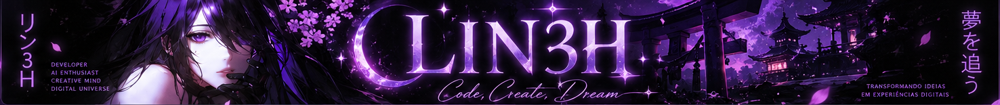
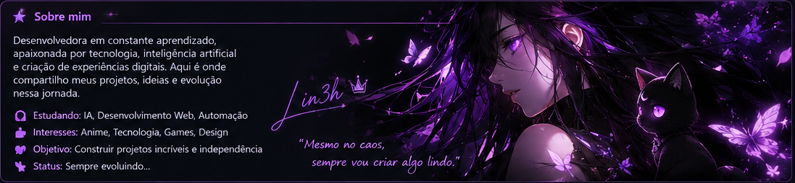
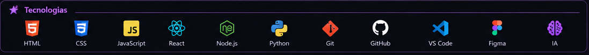
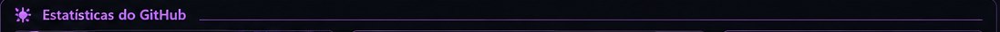
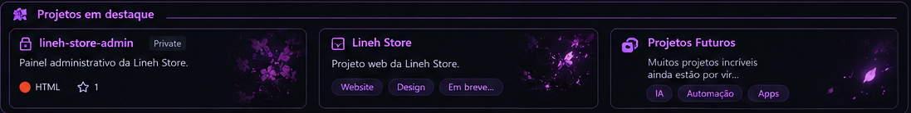
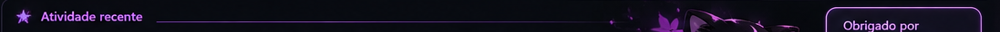
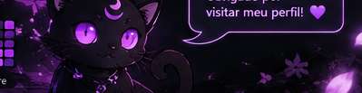

 

 

<!-- Os cartões abaixo exibem dados fornecidos por serviços externos. Eles não são os números fictícios da imagem de referência. -->

> ✦ O painel ilustrado de projetos reproduz o design escolhido. Ele não representa um inventário em tempo real; o repositório **lineh-store-admin** é privado e não fica disponível publicamente.

✦ Code · Create · Dream ✦

