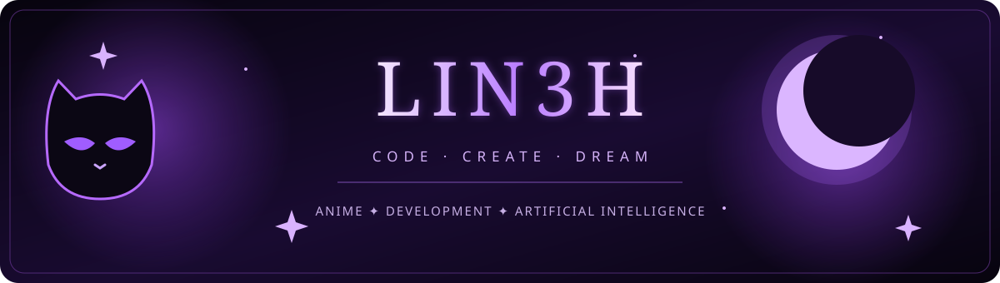

 

---

### 🌙 Sobre mim

Olá! Sou **Linokah** (`@Lin3h`). Gosto de unir **criatividade, tecnologia e inteligência artificial** para transformar ideias em experiências digitais. Estou sempre aprendendo, experimentando e construindo projetos.

- 💜 **Interesses:** anime, design, tecnologia e jogos.
- 🪄 **Explorando:** desenvolvimento web, programação e IA.
- ✨ **Estilo:** interfaces minimalistas, preto e roxo e experiências visuais.
- 🚀 **Objetivo:** evoluir a cada projeto.

### 🦋 Tecnologias que estou explorando

> Estes ícones representam áreas de interesse e aprendizado, não certificações ou nível de proficiência.

### 🔮 Projetos

| Projeto | Sobre |
|:--|:--|
| **Lineh Store** | Projetos e experiências digitais da marca. |
| **Novas ideias** | Experimentos com design, IA e desenvolvimento web. |

> Alguns dos meus projetos são privados e não aparecem publicamente no GitHub.

### 📊 Minha atividade

> Os cartões acima dependem de serviços externos e podem não aparecer se o serviço estiver indisponível. Projetos privados não são expostos aqui.

### 🐈‍⬛ Meu pequeno universo

*“Sempre aprendendo. Sempre criando.”*

**Obrigada pela visita! 💜**

