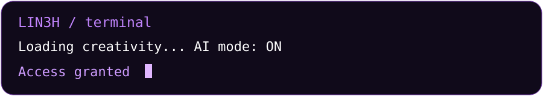
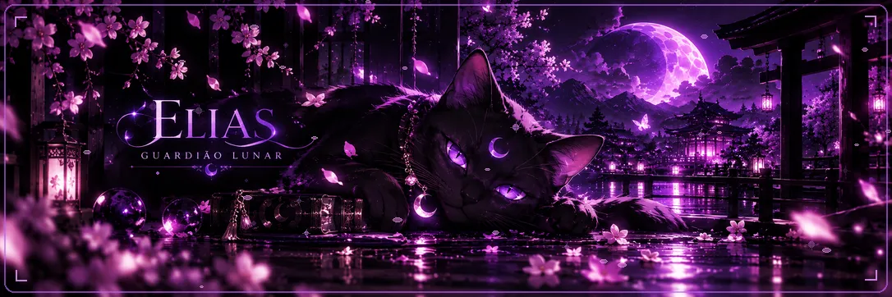
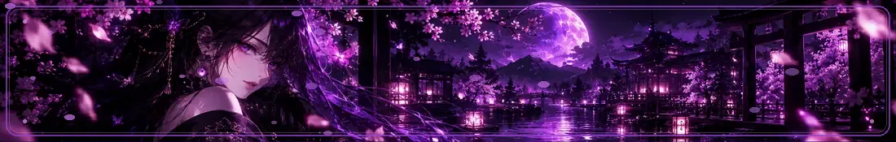
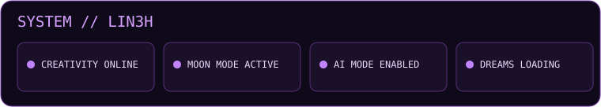
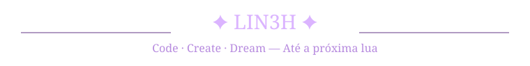
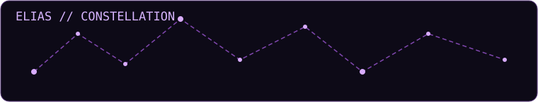
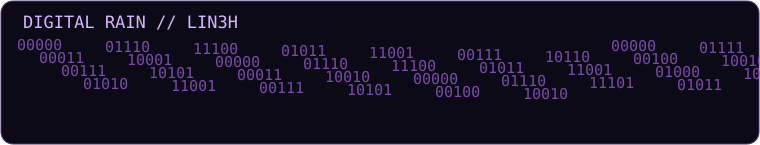
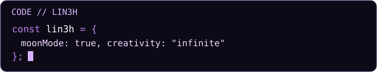

<!-- Minhas redes LIN3H -->

  
    
    
    
    
    

<!-- Fim minhas redes -->

<!-- Extras do universo LIN3H -->

<!-- Fim extras -->

<!-- O painel animado acima é uma ilustração. Números, barras e contribuições desenhados na arte são ilustrativos. -->

<table>
<tr>
<td align="center" width="50%"></td>
<td align="center" width="50%"></td>
</tr>
<tr>
<td align="center" width="50%"></td>
<td align="center" width="50%"></td>
</tr>
</table>

Dados públicos de serviços externos, sujeitos a cache e indisponibilidade. Os números desenhados no banner animado são ilustrativos.

<!-- Jardim Lunar entre estatísticas e contribuições -->

<strong>🐍 COBRINHA DAS CONTRIBUIÇÕES</strong>

<!-- LIN3H: encerramento programado em SVG (sem JavaScript e sem banners fotográficos) -->

<!-- Fim do rodapé LIN3H -->

<!-- Componentes programados: constelações, chuva digital, código e projetos públicos -->

### ✦ Projetos públicos · LIN3H

<a href="https://github.com/Lin3h?tab=repositories">↗ Explorar todos os repositórios públicos</a>

<!-- Fim dos componentes programados -->

