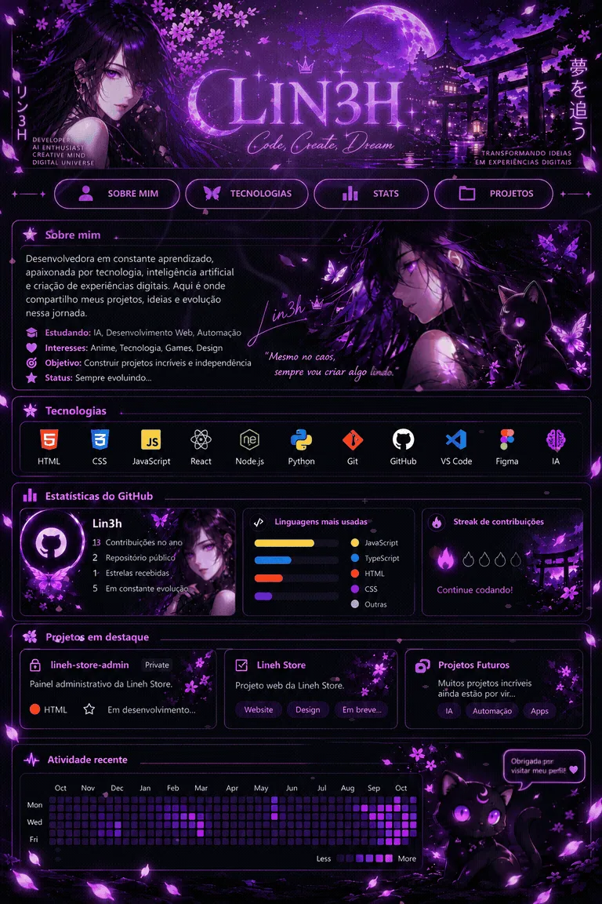

<!-- Minhas redes LIN3H -->

  
    
    
    
    
    

<!-- Fim minhas redes -->

<!-- O painel animado acima é uma ilustração. Números, barras e contribuições desenhados na arte são ilustrativos. -->
<h3 align="center">💜 Estatísticas reais do GitHub</h3>

  

 

 

 
Os cartões mostram dados públicos fornecidos por serviços externos; valores podem estar em cache e nenhum número é inventado.
 
Estatísticas obtidas de serviço externo, sujeitas a cache ou indisponibilidade. A arte acima contém números ilustrativos.

